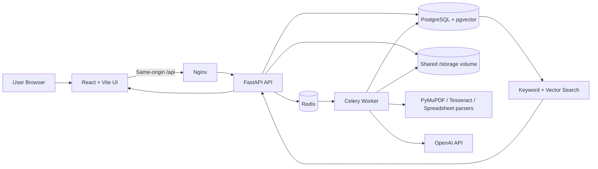
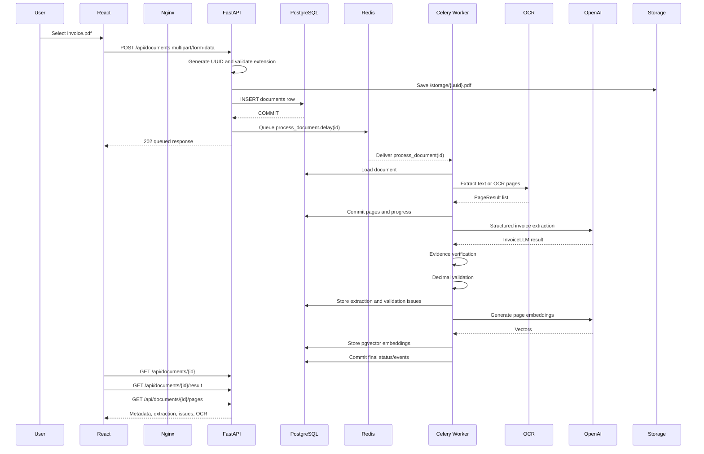
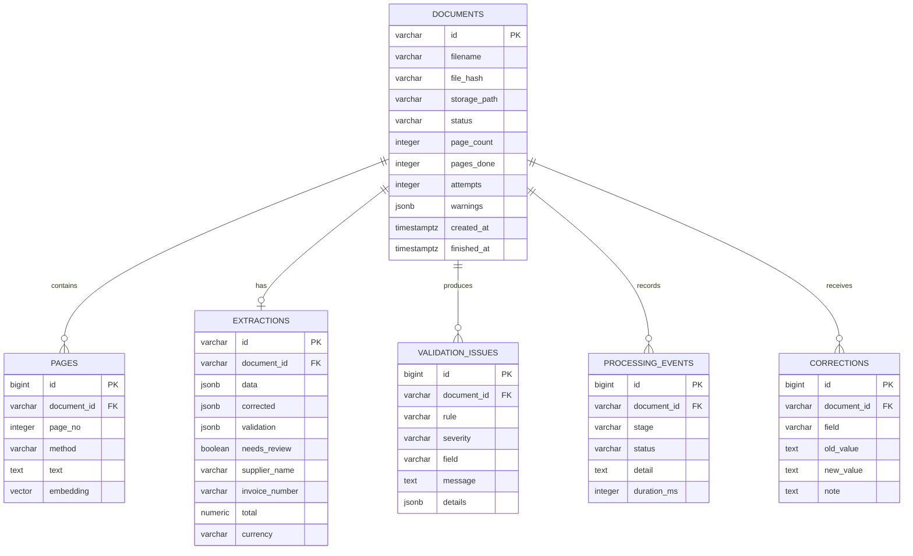
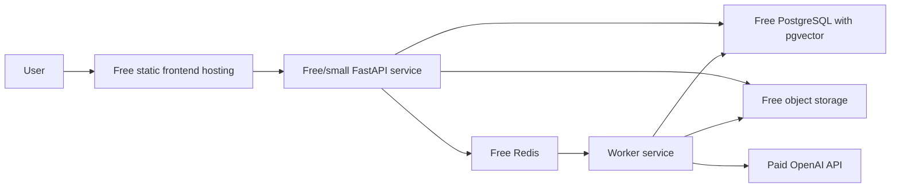

# DocIntel architecture and deployment report

## Executive summary

DocIntel is a Docker Compose application consisting of:

- React/Vite frontend served by Nginx
- FastAPI backend
- Celery worker
- Redis broker/result backend
- PostgreSQL 16 with pgvector
- Shared `/storage` volume for original files
- OCR and document-routing pipelines
- OpenAI structured extraction and embedding integrations
- PostgreSQL full-text and vector search

The core processing workflow is implemented end to end. The main production limitations are:

1. No migration framework; startup uses `Base.metadata.create_all()`.
2. Local Docker storage is not suitable for multi-host production.
3. Upload files and database rows are not committed atomically.
4. No orphan-file reconciliation process exists.
5. API authentication is optional.
6. Redis has no configured password, TLS, or persistence.
7. Direct API and PostgreSQL host ports are exposed by Compose.
8. Monitoring and alerting are minimal.
9. Evaluation measures routing/OCR, not extraction accuracy.
10. Recovery backups and generated frontend build artifacts should not be included in a public deployment repository.

No files, containers, databases, volumes, or tests were modified or started during the inspection.

## 1. Architecture overview

### User perspective

1. The user selects invoice files in the React UI.
2. The browser sends multipart files to `POST /api/documents`.
3. FastAPI saves each file under `/storage`.
4. FastAPI creates a `documents` database row.
5. A Celery task is queued through Redis.
6. The worker reads the file, performs OCR or text extraction, and sends the text to OpenAI.
7. The result is verified against the source text.
8. Deterministic validation checks amounts, dates, duplicates, line items, and payment balances.
9. Page text, extraction data, validation issues, and processing events are stored.
10. The frontend polls the API and displays the result, evidence, issues, OCR text, and history.

### System diagram



### Technology choices

| Technology | Reason |
|---|---|
| React | Component-based document review interface |
| Vite | Fast frontend development and production bundling |
| FastAPI | Typed HTTP API, automatic OpenAPI documentation, dependency injection |
| SQLAlchemy | ORM, transactions, relationships, PostgreSQL access |
| PostgreSQL | Durable relational storage and queryable validation metadata |
| pgvector | Stores 1536-dimensional embeddings for semantic search |
| Redis | Fast Celery broker and result backend |
| Celery | Moves OCR/LLM work outside the request-response cycle |
| PyMuPDF | PDF text extraction and page rendering |
| Tesseract | OCR for scanned pages and images |
| OpenAI structured output | Converts document text into typed invoice fields |
| Docker Compose | Reproducible local multi-service environment |
| Nginx | Serves compiled frontend assets and proxies `/api` requests |

## 2. File-by-file walkthrough

### Frontend

#### `frontend/src/App.jsx`

Main React composition root. It composes `Upload`, `DocumentList`, `DocumentDetail`, `Search`, and `StatsBar`. It stores the selected document ID and a refresh counter.

#### `frontend/src/api.js`

Central API client. It defines the request helper and wrappers for uploads, document listing, details, results, pages, corrections, approval, reprocessing, search, and statistics. `VITE_API_BASE` controls whether requests use same-origin routing or a separate API origin.

#### `frontend/src/components/Upload.jsx`

Handles file selection, drag-and-drop, batching, and upload status. Files are submitted in groups of 20.

#### `frontend/src/components/DocumentList.jsx`

Polls `GET /api/documents`, polling faster while documents are `queued` or `processing`.

#### `frontend/src/components/DocumentDetail.jsx`

Displays status, progress, validation issues, extracted fields, evidence, line items, corrections, OCR text, and processing events. It renders all returned line items.

#### `frontend/src/components/Search.jsx`

Supports keyword search, semantic search, supplier filtering, status filtering, and invoice-date filtering.

#### `frontend/src/components/StatsBar.jsx`

Polls `/api/stats` and displays document counts, success rate, and median processing time.

#### `frontend/src/constants.js`

Defines field labels, statuses, error messages, and formatting helpers.

#### `frontend/src/styles.css`

Contains the dark-theme UI styling.

#### `frontend/vite.config.js`

Defines the React plugin, development port `5173`, development `/api` proxy, and Vitest configuration.

#### `frontend/Dockerfile`

Uses a multi-stage build: Node builds `dist`, then Nginx serves the compiled output.

#### `frontend/nginx.conf`

Proxies `/api/*` to `http://api:8000` and serves the React single-page application.

### Backend API

#### `backend/app/main.py`

Creates the FastAPI application, configures lifespan startup, waits for the database, calls `init_db()`, configures CORS, registers routes, defines `/health`, and normalizes the OpenAPI upload schema.

#### `backend/app/api/documents.py`

Defines upload, listing, detail, result, page, correction, approval, reprocessing, search, and statistics endpoints.

Important functions:

- `upload_documents()`
- `list_documents()`
- `document_detail()`
- `document_result()`
- `document_pages()`
- `correct_document()`
- `approve_document()`
- `reprocess_document()`
- `reprocess_failed()`
- `search()`
- `stats()`

#### `backend/app/api/deps.py`

Defines optional API-key authentication using the `X-API-Key` header.

#### `backend/app/config.py`

Defines environment-backed settings for database, Redis, storage, upload limits, authentication, CORS, and OpenAI models. `get_settings()` is cached.

#### `backend/app/services.py`

Provides replaceable factories for the LLM client and embedding client. Tests replace these with deterministic fakes.

### Database and models

#### `backend/app/db/session.py`

Defines database-engine and sessionmaker factories, cached production accessors, the FastAPI `get_db()` dependency, and `init_db()`.

#### `backend/app/db/models.py`

Defines the ORM models:

- `Document`
- `Page`
- `Extraction`
- `ValidationIssue`
- `ProcessingEvent`
- `Correction`

It also defines the 1536-dimensional embedding column configuration.

#### `backend/app/db/ops.py`

Defines:

- `effective_extraction()` — merges AI output with human corrections.
- `denormalize()` — copies common values into indexed columns.
- `revalidate_and_store()` — validates data, persists validation results, creates issue rows, and updates status.

#### `docs/DB_SCHEMA.sql`

Documents the PostgreSQL schema, foreign keys, indexes, and pgvector indexes.

### Document processing and OCR

#### `backend/app/pipelines/router.py`

`process_file()` is the main file-processing entry point. It validates file existence and size, detects the type, dispatches to the correct processor, and returns a `ProcessedDocument`.

#### `backend/app/pipelines/detect.py`

Detects file type using magic bytes rather than trusting extensions. It supports PDF, PNG, JPEG, TIFF, XLSX, XLS, CSV, and TSV.

#### `backend/app/pipelines/pdf.py`

Processes PDFs page by page. It uses the native text layer when sufficient and falls back to OCR when needed.

#### `backend/app/pipelines/image.py`

Processes JPG, PNG, and multi-frame TIFF files, including EXIF rotation and per-frame OCR.

#### `backend/app/pipelines/ocr.py`

Converts images to grayscale, fixes orientation, deskews, runs a light OCR pass, and escalates to stronger preprocessing when confidence is low.

#### `backend/app/pipelines/spreadsheet.py`

Processes XLSX, XLS, and CSV files. It preserves raw values, detects headers, treats sheets as logical pages, and produces searchable text.

#### `backend/app/pipelines/models.py`

Defines the framework-independent `PageResult`, `SheetData`, and `ProcessedDocument` dataclasses.

### Extraction and validation

#### `backend/app/extraction/schema.py`

Defines the Pydantic `Field`, `LineItem`, and `InvoiceLLM` schemas. Values remain strings during extraction to avoid floating-point monetary errors.

#### `backend/app/extraction/prompts.py`

Defines rules for non-invented values, exact evidence, dates, amounts, currency, party blocks, line items, quantities, units, tax, discounts, and confidence.

#### `backend/app/extraction/llm.py`

The only module directly coupled to OpenAI. `OpenAIClient.extract()` uses OpenAI structured output with the `InvoiceLLM` schema.

#### `backend/app/extraction/verify.py`

Defines source normalization and verification functions:

- `norm()`
- `source_contains()`
- `numbers_in()`
- `to_decimal()`
- `to_rate()`
- `check_field()`
- `check_line_item()`

Unsupported values are removed rather than silently persisted.

#### `backend/app/extraction/extractor.py`

Builds source text, calls the LLM, verifies scalar fields and line items, applies party-layout fallbacks, applies invoice-table row fallback, and generates review flags.

#### `backend/app/validation/validator.py`

Performs deterministic validation for required fields, uncertain fields, numeric sanity, dates, tax, discounts, shipping, other charges, payments, balances, line totals, duplicates, and possible OCR errors.

Money arithmetic uses `Decimal`.

#### `backend/app/validation/models.py`

Defines `Issue` and `ValidationReport` with `error`, `warning`, and `info` severities.

#### `backend/app/validation/duplicates.py`

Defines duplicate-detection interfaces and normalized comparison keys.

#### `backend/app/validation/db_index.py`

Implements duplicate lookup against PostgreSQL.

### Embeddings and vector search

#### `backend/app/search/embeddings.py`

Generates OpenAI embeddings in batches of 32 and limits each page to 8,000 characters.

#### `backend/app/search/search.py`

Implements PostgreSQL keyword search and pgvector semantic search. Keyword search uses `to_tsvector`, `websearch_to_tsquery`, `ts_rank`, and `ts_headline`. Semantic search uses cosine distance.

Embedding failures are best effort: the document can still complete, and keyword search remains available.

### Celery and Redis

#### `backend/app/workers/celery_app.py`

Creates Celery with Redis as broker and result backend. It configures late acknowledgements, worker-loss redelivery, prefetch control, task tracking, time limits, and broker startup retry.

#### `backend/app/workers/tasks.py`

Defines the `process_document(doc_id)` Celery task.

#### `backend/app/workers/pipeline.py`

`run_pipeline()` loads the document, clears derived data for reprocessing, persists pages and progress, performs extraction and validation, generates embeddings, records processing events, and sets the final status.

### Docker and infrastructure

#### `docker-compose.yml`

Defines `db`, `redis`, `api`, `worker`, and `frontend`, plus `pgdata` and `storage` volumes.

#### `backend/Dockerfile`

Installs Python, Tesseract, image libraries, and Python dependencies.

#### `frontend/Dockerfile`

Builds the Vite frontend and serves it with Nginx.

### Tests and evaluation

#### `backend/tests/conftest.py`

Generates PDF, image, spreadsheet, and CSV fixtures at runtime.

#### `backend/tests/test_task1_processing.py`

Tests routing, OCR, PDF, image, spreadsheet, corruption, and file handling.

#### `backend/tests/test_task2_extraction.py`

Tests schemas, evidence verification, line items, percentages, and party parsing.

#### `backend/tests/test_task3_validation.py`

Tests arithmetic, missing fields, duplicates, and validation rules.

#### `backend/tests/test_task4_api.py`

Tests API behavior, worker integration, persistence, search, authentication, reprocessing, and test-database isolation.

#### `backend/tests/db_isolation.py`

Rejects destructive cleanup unless the database name is exactly `docintel_test`.

#### `backend/tests/test_openapi.py`

Checks the upload schema and binary format declaration.

#### `evaluation/run.py`

Measures file routing, page count, OCR/text markers, processing success, and elapsed time. It does not measure LLM extraction accuracy.

#### `evaluation/results.json`

The recorded result is two passed records, 100% routing/text-processing success, 0% processing failure, and a mean measured time of 2647.69 ms.

## 3. End-to-end execution story



### Exact lifecycle

1. `Upload.jsx` calls `api.upload(files)`.
2. `api.js` builds multipart `FormData` using the `files` field.
3. `upload_documents()` receives the files.
4. The endpoint sanitizes the display name and generates a UUID path.
5. The file is saved to `/storage/{uuid}.{extension}`.
6. SHA-256 and size are calculated.
7. A `Document` row is inserted and committed.
8. `process_document.delay(doc.id)` sends a task to Redis.
9. The worker invokes `run_pipeline(doc_id)`.
10. `process_file()` routes the file.
11. Page results are committed as they finish.
12. `extract_from_document()` calls the structured LLM client.
13. Evidence verification rejects unsupported values.
14. `revalidate_and_store()` persists extraction and validation data.
15. Page embeddings are generated and saved to `Page.embedding`.
16. The frontend polls detail, result, and page endpoints.

## 4. Database deep dive



Original binaries live in `/storage`. PostgreSQL stores metadata, page text, structured extraction, validation, events, corrections, and embeddings.

Foreign keys use `ON DELETE CASCADE`. One document has many pages, validation issues, events, and corrections, and at most one extraction.

The API and worker use SQLAlchemy sessions. The workflow commits document metadata, page progress, extraction/validation, and final embedding/status changes separately. Therefore partial processing data may be committed if a later stage fails.

Production uses `docintel`; tests explicitly use `docintel_test`, override the API dependency, override the worker sessionmaker, and guard destructive cleanup by exact database name.

## 5. Important technical concepts

### FastAPI lifecycle and dependency injection

FastAPI validates requests, resolves dependencies, executes route functions, and serializes responses. `Depends(get_db)` supplies SQLAlchemy sessions, and tests replace that dependency with a test session.

### SQLAlchemy sessions and transactions

A session tracks ORM objects and commits changes. `db.commit()` makes a transaction durable. The upload commit occurs before Celery enqueueing.

### Celery and Redis

Celery sends task messages to Redis. A worker consumes the message and runs `process_document()`. This prevents OCR and LLM work from blocking the HTTP request.

### OCR

OCR converts image pixels into text. DocIntel uses PyMuPDF, Tesseract, OpenCV, grayscale conversion, orientation detection, deskewing, and confidence-based preprocessing escalation.

### Structured extraction

OpenAI returns a typed `InvoiceLLM`. Each field includes value, confidence, and evidence. The application verifies the result against source text rather than trusting the model blindly.

### Embeddings and vector search

Embeddings are numeric representations of page meaning. They are stored in pgvector and compared with cosine distance for semantic search. PostgreSQL full-text search provides a separate keyword path.

### Docker

Images package runtime dependencies. Containers run the services. Volumes persist PostgreSQL data and uploaded files. Compose connects services through internal DNS names such as `db`, `redis`, and `api`.

### Environment variables

Environment variables configure deployment-specific values and secrets, including `OPENAI_API_KEY`, `DATABASE_URL`, `REDIS_URL`, `API_KEY`, and `CORS_ORIGINS`.

### Authentication and CORS

Authentication is currently an optional shared API key. CORS is configured from `CORS_ORIGINS`. Public production deployment should require authentication, HTTPS, and exact allowed origins.

### Error handling, retries, and idempotency

Worker failures are recorded in document status and processing events. Celery supports broker retry and worker-loss redelivery. Application-level reprocessing is available. The workflow is not fully idempotent: duplicate uploads create new rows, and file/database operations are not atomic.

## 6. Deployment-readiness audit

### Secrets and configuration

The default database password is `app` if no override is supplied. API-key authentication is optional. Production should use a secret manager, remove defaults, require authentication, and keep `.env`, dumps, and private storage archives outside the repository.

**Severity: Critical**

### Docker and Compose

Compose is suitable for local development but currently bind-mounts backend source, exposes the API directly, publishes PostgreSQL for local pgAdmin access, lacks restart policies, and has no explicit resource limits.

Use immutable production images, remove source mounts, remove public database ports, add resource/restart policies, and create a production Compose override.

**Severity: High**

### Database and migrations

Startup uses `CREATE EXTENSION IF NOT EXISTS vector` and `Base.metadata.create_all(engine)`. This does not safely support schema changes, renames, backfills, or rollback migrations.

Add Alembic and run migrations as a controlled release step.

**Severity: High**

### Storage

Local Docker storage is host-specific. File saving and database insertion are separate, so orphan files can remain after database failures. No reconciliation process exists.

Use S3-compatible object storage, store object keys, add orphan reconciliation, quotas, monitoring, and retention.

**Severity: High**

### Celery and Redis

Redis has no configured password, TLS, persistence, queue monitoring, or explicit production resource policy. Worker reliability depends on shared storage access.

Use managed Redis or enable authentication, TLS, persistence, memory limits, queue monitoring, and worker restart policies.

**Severity: High**

### Authentication, CORS, and HTTPS

An empty `API_KEY` means unauthenticated API access. There is no full user identity or role system and no HTTPS in the local Compose configuration.

Require authentication, HTTPS, exact CORS origins, and rate limiting for a public deployment.

**Severity: Critical for public deployment**

### API and database exposure

The API is exposed on port 8000 and PostgreSQL is mapped to loopback port 5433 for local access. Remove the database mapping in production and expose the API only through a reverse proxy or load balancer.

**Severity: High**

### Test isolation

The test setup explicitly creates `docintel_test`, overrides API and worker sessions, and protects destructive cleanup. The production-rejection regression should explicitly construct a `docintel` URL to make its assertion independent of the starting environment.

**Severity: Medium**

### Logging and monitoring

The project has a database health endpoint, processing events, logs, and aggregate statistics, but lacks centralized logs, metrics, queue monitoring, alerting, disk monitoring, and OpenAI cost/latency monitoring.

**Severity: Medium**

### Backup and restore

There is no automated backup service in the application. Production requires scheduled PostgreSQL backups, object-storage snapshots or versioning, off-host retention, restore tests, and documented recovery objectives.

**Severity: Critical**

## 7. Free-tier deployment plan



Static frontend hosting such as Cloudflare Pages, Netlify, or Vercel is suitable for the Vite build.

Free container hosting may support FastAPI but commonly includes sleeping services, cold starts, limited RAM, request timeouts, and ephemeral filesystems.

Celery is the hardest free-tier component. Free services may sleep, terminate long jobs, or fail to keep a worker available. This is acceptable for a demonstration but not reliable production infrastructure.

The PostgreSQL provider must explicitly support pgvector, HNSW indexes, sufficient storage, and acceptable connection limits. Free Redis must be checked for TLS, persistence, memory limits, and idle expiration.

OpenAI is not generally free. Use spending limits, token tracking, document-size limits, embedding reuse, and suitable lower-cost models.

An entirely free deployment can demonstrate the UI and API, but a small paid VPS or managed deployment is more realistic for reliable OCR workers and persistent storage.

## 8. Interview preparation

### Two-minute explanation

DocIntel is a Dockerized document-intelligence platform for invoices and business documents. Users upload PDFs, images, spreadsheets, or CSV files through a React frontend. FastAPI validates and stores the original file, creates a document record in PostgreSQL, and queues background processing through Celery and Redis. The worker routes the file to native PDF extraction, OCR, or spreadsheet parsing. The resulting text is sent to OpenAI using a typed structured-output schema. Every extracted value includes confidence and source evidence, and deterministic verification removes values that cannot be found in the source. A validation layer checks required fields, arithmetic, tax and discount handling, duplicate invoices, line totals, and payment balances. Pages, extraction JSON, validation issues, processing events, and embeddings are stored in PostgreSQL. The frontend polls the API and displays status, evidence, OCR text, validation issues, corrections, and search results. PostgreSQL full-text search supports keyword search, while pgvector and OpenAI embeddings support semantic search.

### Five-minute walkthrough

1. React uploads a multipart request.
2. FastAPI sanitizes the filename and generates a server-side UUID.
3. The file is stored in `/storage`.
4. A `documents` row is committed.
5. Celery receives a document ID through Redis.
6. The worker routes the file.
7. PDFs use native text when sufficient; otherwise pages are rendered and OCRed.
8. Images use Tesseract with deskewing and preprocessing.
9. Spreadsheets are parsed with pandas while preserving raw values.
10. The worker builds source text and calls OpenAI structured output.
11. Evidence verification checks every value against source text.
12. Validation runs with Decimal arithmetic.
13. Extraction JSON and validation issues are persisted.
14. Page embeddings are generated and saved to pgvector.
15. The frontend polls document status and retrieves the result.
16. Human corrections are stored separately and revalidated.
17. Search uses PostgreSQL full-text or cosine vector similarity.

### Interview questions

1. **Why is Celery used?** OCR and LLM extraction are slow and should not block the upload request.
2. **Why is Redis needed?** It transports Celery task messages and stores task results.
3. **Is upload synchronous?** No. The endpoint returns after saving and committing the document.
4. **When is the document row committed?** Before Celery enqueueing.
5. **What if enqueueing fails?** The row remains and is marked `failed` with `queue_unavailable`.
6. **What if database insertion fails after file save?** An orphan file can remain.
7. **How are filenames secured?** Display names are sanitized and actual paths use generated UUIDs.
8. **Why use magic bytes?** Extensions can be renamed or falsified.
9. **How does PDF processing choose OCR?** It uses the native text layer when sufficient; otherwise OCR.
10. **How is OCR confidence used?** Low confidence triggers stronger preprocessing.
11. **Why structured LLM output?** It constrains the response to a typed schema.
12. **Why retain evidence?** It enables source traceability.
13. **Does evidence verification prove correctness?** No; it proves source presence, not interpretation.
14. **Why use Decimal?** It avoids binary floating-point money errors.
15. **How are percentages represented?** Tax and discount may remain strings such as `10%`.
16. **How are quantities represented?** Quantity and unit are separate fields.
17. **How are missing values represented?** As `null`, displayed as missing.
18. **How are validation issues stored?** In extraction JSON and queryable issue rows.
19. **What causes `needs_review`?** Any error or warning.
20. **How are corrections handled?** They are stored separately and revalidated.
21. **What is `effective_extraction()`?** AI data merged with human corrections.
22. **How does keyword search work?** PostgreSQL full-text search and ranking.
23. **How does semantic search work?** Query embedding compared with page vectors using cosine distance.
24. **Why page-level embeddings?** They provide focused semantic matches and snippets.
25. **What if embeddings fail?** The document can still complete and keyword search remains available.
26. **What is the migration limitation?** `create_all()` is not a versioned migration system.
27. **How does dependency injection help testing?** Tests replace `get_db` with a test session.
28. **How is cleanup protected?** It rejects engines not connected to `docintel_test`.
29. **What is CORS?** Browser-origin access control.
30. **What is the authentication model?** An optional shared API key.
31. **What is not implemented?** Full user auth, migrations, object-storage abstraction, orphan reconciliation, and production monitoring.
32. **Why commit pages incrementally?** To expose progress and preserve successful pages.
33. **Is the pipeline fully transactional?** No. Stages commit independently.
34. **How are failed documents retried?** Through the reprocessing endpoints.
35. **How does Celery handle worker loss?** Late acknowledgements and redelivery settings support retry.

## 9. Learning roadmap

### Stage 1: Topology

Read:

- `README.md`
- `docker-compose.yml`
- `backend/Dockerfile`
- `frontend/Dockerfile`
- `frontend/nginx.conf`

Safe commands:

```powershell
docker compose config
docker compose ps
```

Understand services, networks, volumes, environment overrides, and internal versus host ports.

### Stage 2: Frontend

Read:

- `frontend/src/App.jsx`
- `frontend/src/api.js`
- `frontend/src/components/Upload.jsx`
- `frontend/src/components/DocumentList.jsx`
- `frontend/src/components/DocumentDetail.jsx`

Trace one upload from the button click to `api.upload()`.

### Stage 3: FastAPI

Read:

- `backend/app/main.py`
- `backend/app/api/documents.py`
- `backend/app/api/deps.py`
- `backend/app/config.py`

Map every frontend API call to its backend route.

### Stage 4: Database

Read:

- `backend/app/db/models.py`
- `backend/app/db/session.py`
- `backend/app/db/ops.py`
- `docs/DB_SCHEMA.sql`

Map one document ID across every table.

### Stage 5: Processing

Read:

- `backend/app/pipelines/router.py`
- `backend/app/pipelines/detect.py`
- `backend/app/pipelines/pdf.py`
- `backend/app/pipelines/image.py`
- `backend/app/pipelines/ocr.py`
- `backend/app/pipelines/spreadsheet.py`

Classify each sample file by expected processing path.

### Stage 6: Extraction

Read:

- `backend/app/extraction/schema.py`
- `backend/app/extraction/prompts.py`
- `backend/app/extraction/llm.py`
- `backend/app/extraction/extractor.py`
- `backend/app/extraction/verify.py`

Identify which values should survive source verification.

### Stage 7: Validation

Read:

- `backend/app/validation/validator.py`
- `backend/app/validation/models.py`
- `backend/app/validation/duplicates.py`
- `backend/app/validation/db_index.py`

Calculate whether a sample invoice should be `completed` or `needs_review`.

### Stage 8: Celery

Read:

- `backend/app/workers/celery_app.py`
- `backend/app/workers/tasks.py`
- `backend/app/workers/pipeline.py`

Draw the Redis message lifecycle for one document ID.

### Stage 9: Search

Read:

- `backend/app/search/search.py`
- `backend/app/search/embeddings.py`
- `frontend/src/components/Search.jsx`

Compare when keyword search is preferable to semantic search.

### Stage 10: Testing and deployment

Read:

- `backend/tests/test_task4_api.py`
- `backend/tests/db_isolation.py`
- `docs/TEST_RESULTS.md`
- `evaluation/run.py`
- `docs/EVALUATION_REPORT.md`

Explain why a 100% routing score does not prove extraction accuracy.

## Final recommendation

The project is architecturally coherent and suitable for a controlled portfolio demonstration. Before public production deployment, prioritize:

1. Remove private backups and generated artifacts from the repository.
2. Add strong secret management and mandatory authentication.
3. Remove direct database/API exposure.
4. Add Alembic migrations.
5. Move files to durable object storage.
6. Add orphan reconciliation.
7. Harden Redis.
8. Add worker, queue, disk, API, and OpenAI monitoring.
9. Test database restore procedures.
10. Add a labeled extraction benchmark before claiming extraction accuracy.
